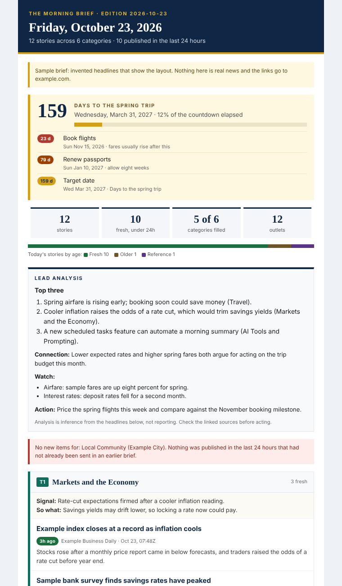

# Daily Brief

A free morning news brief that runs on GitHub. You answer a short setup
interview (what you follow, which categories, how fresh, how many stories,
when it should arrive), and every morning GitHub's servers collect the news,
build an executive SITREP newsletter, and deliver it to you: fresh, on-topic
stories in each category you chose, and nothing you have already been sent.

Free services only: Google News RSS and publisher feeds need no keys, GitHub
Actions runs it, and it arrives as a GitHub issue (no password at all) or by
email through your own mail account. No AI, search API or paid service is
involved. Categories are yours: start from 22 ready-made ones or describe your
own in plain words.



## 1. Open the app

### [OWNER.github.io/daily-brief-sitrep](https://OWNER.github.io/daily-brief-sitrep/)

Open the link on a computer, tablet or phone. It runs the setup interview, edits
your categories, shows the newsletter, and makes your settings file. Your
settings stay in that browser. On a tablet, Share, Add to Home Screen (iPad) or
Install app (Android Chrome) keeps it one tap away.


## 2. Run it on GitHub every morning

1. In the app, answer the questions. Question 7 sets the delivery time, your
   time zone, and how it arrives.
2. On this page choose **Use this template**, and create a **private**
   repository from it.
3. In the app, step 4, **Download the settings file**, then upload it to your
   copy (**Add file**, **Upload files**).
4. For email, add four secrets to your copy (`SMTP_HOST`, `SMTP_USER`,
   `SMTP_PASSWORD`, `MAIL_TO`). For a GitHub issue, add nothing.
5. Paste the two schedule lines the app gives you into
   `.github/workflows/daily-brief.yml`, then press **Run workflow** under
   **Actions** to test.

Every step, with the details GitHub checks, is in
[docs/GITHUB-CLOUD.md](docs/GITHUB-CLOUD.md).

## Other ways to use it

| Way | What it gives you |
|---|---|
| An AI assistant (Claude, ChatGPT, Gemini, Grok) | The same interview, a brief written from a live web search, and a Lead Analysis. Step 5 of the app gives the prompt and the steps. See [docs/AI-ASSISTANTS.md](docs/AI-ASSISTANTS.md). |
| The desktop app | The same collection and email from your own computer: install Python 3.9 or newer from python.org, download this project (**Code**, **Download ZIP**), and double-click `Start-Windows.bat`, `Start-Mac.command` or `start-linux.sh`. On a Mac, the first time, right-click `Start-Mac.command` and choose **Open**, and run **Install Certificates.command** from the Python folder in Applications. |
| The web page alone | Preview a brief pasted from an AI, save an email draft (.eml), or copy it into a new email. |

News sites do not let a web page read their feeds, so the web page itself
cannot fetch the news; your GitHub copy, the desktop app, or an AI assistant
does.

## The five steps in the app

| Step | What you do |
|---|---|
| 1 Setup | Eight questions, each with a sensible default |
| 2 Categories | Add, remove, reorder and fine-tune categories |
| 3 Brief | See the sample, paste a brief from an AI, or (desktop app) get today's |
| 4 Email | Set up the GitHub run, or send, save or copy the newsletter |
| 5 AI assistants | Copy the prompt for Claude, ChatGPT, Gemini or Grok |

## How stories are picked

1. Each category runs its searches. A story stays only if it mentions at least
   one term from every "must mention" line and none of the "leave out" terms.
   Social media posts and paperwork notices are dropped.
2. **NEWS** is published inside your window (24 hours by default). When a
   category is short, **OLDER** stories fill in, stamped with their true age.
   Undated official pages appear last, labelled **REFERENCE**.
3. Nothing you have already been sent comes back: not the same link, not the
   same headline, and not the same story from a second outlet. A story appears
   in one category only.
4. A category is never padded. If nothing new turned up, it says so.

[docs/CATEGORIES.md](docs/CATEGORIES.md) explains how to write a category.
[docs/ROADMAP.md](docs/ROADMAP.md) reviews the whole process, the lessons behind
every rule, and the ranked list of improvements.

## Privacy

No account of ours and no tracking. Settings stay in your browser and in your
own private GitHub copy; mail settings are GitHub secrets. The AI prompt and the
settings file never include an email address. See
[docs/PRIVACY.md](docs/PRIVACY.md) and [docs/LIMITS.md](docs/LIMITS.md).

## For developers

```
python -m dailybrief --help        # every command
python -m dailybrief run --config daily-brief-settings.json --out output   # one run, no sending
python -m dailybrief sample        # render the sample newsletter to output/
python -m pytest -q                # the tests
```

Standard library only. The browser engine (`app/js/engine.js`,
`app/js/newsletter.js`) and the Python engine (`dailybrief/`) are twins, and the
parity tests require identical results. See [CONTRIBUTING.md](CONTRIBUTING.md).

| Folder | What is in it |
|---|---|
| `app/` | The app: plain HTML, CSS and JavaScript, no build step |
| `dailybrief/` | Collector, newsletter, mail and issue delivery, schedule gate, desktop app, command line |
| `.github/workflows/` | The daily run, the tests, and the Pages publish |
| `prompt/` | The AI prompt (full and compact) and the category library |
| `examples/` | An invented sample brief and its settings |
| `docs/` | Guides, the roadmap and screenshots |
| `tests/` | Engine, parity, cloud, server, command line and browser tests |

## Licence

MIT. See [LICENSE](LICENSE).
