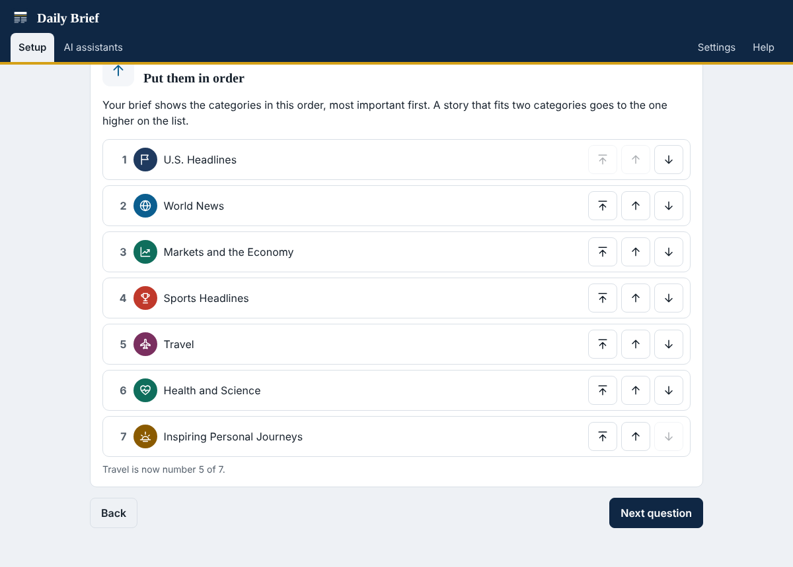
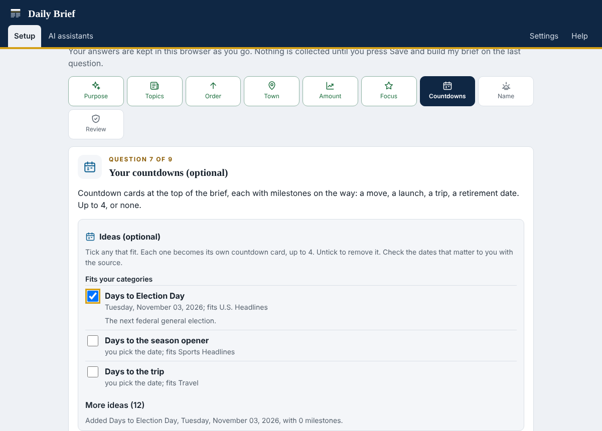

# Daily Brief

Your morning news on one page, free. Open the web address, answer a short
setup interview (what you follow, which categories, your town, how fresh, how
many stories), and the page collects that day's news itself: fresh, on-topic
stories in every category you chose, with publisher photos, a forecast for your
town, and nothing you have already seen.

Your choices stay in your own browser, so each person who opens the address
gets their own brief. Come back any day and press **Get today's brief**, or let
the page collect by itself the first time you open it each day. There is no
account, no sign-up and no key. Every source is free: the GDELT news index and
publisher feeds for the news, and Open-Meteo for the forecast.


## 1. Open the app

### [jbrady0850.github.io/daily-brief-sitrep](https://jbrady0850.github.io/daily-brief-sitrep/)

Open the link on a computer, tablet or phone. Answer the nine questions, press
**Save and build my brief**, and the brief appears as a page a minute later. On a
phone, **Share**, **Add to Home Screen** keeps it one tap away; in Chrome or
Edge on a computer, the install button in the address bar does the same.


## 2. Pick from 67 categories, or type your own

The library has 11 groups: top news, weather, sports, technology, money and
business, science and health, entertainment and culture, life and home, your
area, government and defense, and career and education. Ten packs start you
off (for example **Headlines and weather** or **Sports fan**), and **Type what
you want to follow** turns any topic in your own words into a category.

| Group | Categories |
|---|---|
| Top news | U.S. headlines, world news, politics and policy, business headlines, good news |
| Weather | Severe weather across the country, forecasts and seasonal outlook, climate and environment, weather and safety in your town |
| Sports | Sports headlines, NFL, college football, NBA, college basketball, MLB, NHL, soccer, golf, motorsports, tennis, fantasy sports |
| Technology | Technology headlines, gadgets and reviews, cybersecurity, networks, cloud, enterprise AI, AI tools, open source |
| Money and business | Personal finance, retirement planning, markets and the economy, housing, small business, crypto, energy and gas prices |
| Science and health | Space, science and discovery, health and wellness, health and science |
| Entertainment and culture | Movies, television and streaming, music, books, video games, arts and culture |
| Life and home | Travel, food and dining, cars and electric vehicles, home and garden, pets, parenting and family, outdoors, faith, inspiring stories |
| Your area | Local community, local government, local sports, things to do |
| Government and defense | Military and veterans, defense AI, the federal workforce, pay, retirement and government technology |
| Career and education | Career growth and skills, schools and education |


**Put them in order.** The next question lists the categories you picked, with
buttons to move each one up, down or to the top. The brief shows them in that
order, most important first, and a story that fits two categories goes to the
one higher on the list. **Your choices** has a Change link for the order too.



**Countdowns (optional, up to 4).** The countdown question lists ideas as tick
boxes, and nothing is ticked until you tick it. Each idea you tick becomes its
own countdown card at the top of the brief, with its own milestones; untick it
to remove it. The ideas that fit your categories come first, most important
first, and every other idea is under **More ideas**. Dates that follow a
published rule (Election Day, Thanksgiving, Tax Day, Federal Benefits Open
Season) fill in as soon as you tick them; personal ones (a retirement, a trip, a
move, a launch, an exam, the first day of school, race day, draft day or a
season opener) ask for your date and set the milestones back from it. Federal
retirement, for example, lists the HR estimate, TSP and FEHB choices and the
retirement application (agencies need at least 60 days). Ideas that fit only
some readers (Medicare Open Enrollment,
and the hurricane season outside the Atlantic and Gulf coast states) are never
in the first group. **Your countdowns** below the ideas holds each countdown's
fields to change, with Remove and **Add your own countdown**. A countdown
disappears from the brief once its date has passed.



**Email this brief.** On Today's brief, **Email this brief** opens your phone's
or computer's share menu with the page attached and the brief as the message:
pick Gmail, Outlook, Mail or any other app and press Send. It works on Android
and iPhone and in Edge, Chrome and Safari on a computer. Where a browser cannot
share files (Firefox on a computer, or a downloaded copy opened as a file), the
page is saved and a new email opens with the subject and the start of the
brief; attach the saved page yourself, since email links cannot carry
attachments. The page never sends mail itself and needs no account.

## Set up once, then read it every day

The app has two modes, so you always know where you are.

| Mode | What you see |
|---|---|
| Setting up | Nine questions, each with a sensible default, including your town for the forecast. Nothing is collected until you press **Save and build my brief** on the last question. |
| Your brief | Once saved, the app says **Setup complete**, builds today's brief while it shows each stage, and from then on opens on **Today's brief**. |

After setup the tabs are:

| Tab | What you do there |
|---|---|
| Today's brief | See whether today's brief is ready, build it, open it full screen, download it, copy it or email it |
| Your choices | Your saved answers, with a Change link for each one. Changes take effect only when you press **Save changes**; **Cancel changes** keeps the old ones. **Fine-tune categories** edits searches and filters. |
| Every day | Keep the page handy, turn on the once-a-day automatic build, or set up a GitHub copy |
| AI assistants | Copy the prompt for Claude, ChatGPT, Gemini or Grok, and paste the assistant's brief |


## How stories are picked

1. Each category runs its searches. A story stays only if it mentions at least
   one term from every "must mention" line and none of the "leave out" terms.
   Social media posts and paperwork notices are dropped.
2. **NEWS** is published inside your window (24 hours by default). When a
   category is short, **OLDER** stories fill in, stamped with their true age.
   Undated official pages appear last, labelled **REFERENCE**.
3. Nothing you have already seen comes back: not the same link, not the same
   headline, and not the same story from a second outlet. A story appears in
   one category only.
4. A category is never padded. If nothing new turned up, it says so.

[docs/CATEGORIES.md](docs/CATEGORIES.md) explains how to write a category.
[docs/ROADMAP.md](docs/ROADMAP.md) reviews the whole process, the lessons behind
every rule, and the ranked list of improvements.

## Other ways to use it

| Way | What it gives you |
|---|---|
| An AI assistant (Claude, ChatGPT, Gemini, Grok) | The same interview, a brief written from a live web search, and a Lead Analysis. Paste its reply on the Today tab. See [docs/AI-ASSISTANTS.md](docs/AI-ASSISTANTS.md). |
| A GitHub copy (optional) | GitHub's servers collect the brief from Google News each morning and post it as an issue in your private copy, with no browser open. See [docs/GITHUB-CLOUD.md](docs/GITHUB-CLOUD.md). |
| The desktop app | The same app on your own computer, reading Google News and every publisher feed: install Python 3.9 or newer from python.org, download this project (**Code**, **Download ZIP**), and double-click `Start-Windows.bat`, `Start-Mac.command` or `start-linux.sh`. On a Mac, the first time, right-click `Start-Mac.command` and choose **Open**, and run **Install Certificates.command** from the Python folder in Applications. |

The page never sends email itself (sending from the app was removed in version
0.2.0). The brief is a web page you open, download, copy, or hand to your own
email app with Email this brief; see [CHANGELOG.md](CHANGELOG.md).

## Where the news comes from

| Order | Source | When |
|---|---|---|
| 1 | Publisher feeds that allow web pages (The New York Times, Fox News, CNBC, ESPN, CBS Sports, Wired, NASA, Dark Reading, Industry Dive trade sites and others) | Every brief |
| 2 | The backup collection: a file this project's GitHub workflow rebuilds every four hours from Google News and every library feed, published beside the app; recent stories from the last run stay, so a bad run cannot empty a category | When a category is still short |
| 3 | Local news for your state: the news feeds of about 400 local TV stations, which the same GitHub workflow reads every four hours and publishes as one file per state | For the categories about your town |
| 4 | Event calendars: the community calendar of the nearest local TV station (145 station calendars in 39 states run on CitySpark), asked by your browser for the week's events in your town first, then within 20 miles of it | For Things to Do |
| 5 | The GDELT news index | Only for what is still short, mostly topics you typed |

Everything above is collected by this site and its GitHub workflow. Nothing has
to run on your computer, and no account, key or token is needed.

**Your town.** The town question keeps your town, its state and the nearby
towns or county that count as local; picking your town for the forecast fills in
the state and county. Town searches ask for your town or any of those nearby
places, because a small town's news often names only its county. In the US,
the state also picks which local station file the page reads; the page keeps
the stories that name your town or a nearby place, so your town never leaves
your browser. The question also takes extra news feeds (your town's paper, for
example), with a **Check** button that says whether this page can read them.
If no source answers on a given day, a town category says "Not checked today"
instead of "No new items".

**Things to do.** In the US, Things to Do lists the week's events within 20
miles of your town from the community calendar of the nearest local TV station,
one day at a time so the week shows, each with its day, time and place in a blue
pill. Your browser asks the calendar directly with your town's rounded map
position (from the forecast question, or a town search when the forecast is
off); nothing is copied to GitHub. Each event opens on the station's calendar,
or on the organizer's page. CitySpark runs these calendars and allows personal
viewing; check an event's details with its organizer before you go.

A category may also name **on-topic feeds**, such as a tennis feed for the
tennis category; their stories count as on topic without a must-mention word.
See [docs/CATEGORIES.md](docs/CATEGORIES.md).

## Privacy

No account of ours and no tracking. Settings and the no-repeat history stay in
your browser. The page reads the publisher feeds your categories list and the
backup collection and your state's local news file on its own site, sends the searches of categories still short
to the GDELT news index, and, when the forecast is on,
sends your town's rounded map position to Open-Meteo. For Things to Do it sends
the same rounded position to the nearest station's event calendar (CitySpark). Story photos load from
the publishers' own sites. See [docs/PRIVACY.md](docs/PRIVACY.md) and
[docs/LIMITS.md](docs/LIMITS.md).

## For developers

```
python -m dailybrief --help        # every command
python -m dailybrief run --config daily-brief-settings.json --out output   # one run, nothing posted
python -m dailybrief sample        # render the sample brief page to output/
python tools/icons_source.py       # rebuild app/data/icons.js
python -m pytest -q                # the tests
```

Standard library only. The browser engine (`app/js/engine.js`,
`app/js/newsletter.js`) and the Python engine (`dailybrief/`) are twins, and the
parity tests require identical results. The browser collector
(`app/js/collect.js`) and the Python collector (`dailybrief/collect.py`) share
the forecast code and the brief format. See [CONTRIBUTING.md](CONTRIBUTING.md).

| Folder | What is in it |
|---|---|
| `app/` | The app: plain HTML, CSS and JavaScript, no build step, with the icon set and sample artwork |
| `dailybrief/` | Python collector, page renderer, issue delivery, schedule gate, desktop app, command line |
| `.github/workflows/` | The optional daily run, the tests, and the Pages publish |
| `prompt/` | The AI prompt (full and compact) and the category library |
| `examples/` | An invented sample brief and its settings |
| `tools/` | The source of the icon set |
| `docs/` | Guides, the roadmap and screenshots |
| `tests/` | Engine, parity, collector, cloud, server, command line and browser tests |

## Licence

MIT. See [LICENSE](LICENSE). The icons and artwork were drawn for this project
and are under the same licence.
